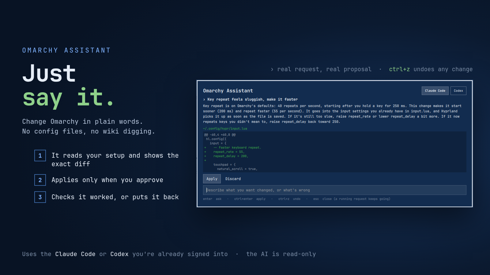

# Omarchy Assistant

**Just say what you want changed. It shows you the exact edit, applies it only when you say
so, checks it worked, and undoes it in one key.**

"Make the gaps smaller." "Key repeat feels sluggish." "SUPER+E should open the file manager."
"Why is my second monitor black?" Type it the way you'd say it. The assistant reads your
setup, works out the right change in the right file, and shows it to you as a diff before
anything is touched. It uses the Claude Code or Codex you're already signed into, so there's
no API key to set up and nothing new to pay for.



### See it work

Ask, read the diff, apply, undo. A real request at real speed (the recorder skips frames where nothing changes):


## Why it's safe to let an AI near your config

The AI never writes anything. It runs read-only, looks around, and hands back a *proposal*.
A small engine you can read in ten minutes (`bin/omarchy-assistant`, Python standard library
only) is the only thing that ever changes a file:

| Step | What happens |
|---|---|
| **You see it first** | Every change is shown as a diff of the exact lines, with a plain explanation of why |
| **Nothing until you approve** | Ctrl+Enter or **Apply**. Discard and nothing was ever written |
| **Backed up** | The original of every file is saved before the first write |
| **Checked** | Hyprland is reloaded and asked for config errors; JSON files are re-parsed |
| **Put back on failure** | If a check fails, every file goes back exactly as it was, automatically |
| **Undo any time** | Ctrl+Z or **Undo last change**, even days later. A theme switch or toggle is reversed too |
| **Won't clobber you** | Undo refuses if you've edited that file since, unless you say "Undo anyway" |

And it keeps to a small corner of your system:

- Edits only your own settings under `~/.config` and your app launchers in
  `~/.local/share/applications`. Never Omarchy's own files, never other plugins' code, never
  anything that looks like keys or credentials (`.ssh`, `gnupg`, `gh`, keyrings, tokens…).
- Every edit is an exact find-and-replace that must match one place in the file, or a new file.
  No "rewrite the whole config".
- It can run only a short fixed list of commands: `hyprctl reload`, `omarchy restart …`,
  `omarchy theme set …`, `omarchy toggle …` and `systemctl --user restart …`.
- Claude Code runs with `--restricted`, file reading and search tools only, plus a handful
  of fixed read-only checks (monitors, keybindings, devices, config errors…). Codex runs in
  its `read-only` sandbox.

## What it's good at

Real requests, run on a stock Omarchy install:

| You say | It does |
|---|---|
| *make the gaps between windows smaller* | Edits `gaps_in`/`gaps_out` in your `looknfeel.lua` |
| *key repeat feels sluggish, make it faster* | Sets `repeat_rate`/`repeat_delay` in your `input.lua`, tells you the defaults and how to fine-tune |
| *SUPER+E should open the file manager* | Checks SUPER+E is free first, then adds the binding to `bindings.lua` |
| *add a German keyboard layout and let me switch with alt+shift* | Adds the layout, keeps Omarchy's Caps Lock options, and warns that Alt+Shift clashes with some Omarchy shortcuts |
| *turn off all animations* / *make inactive windows a bit transparent* | One small, commented edit each |
| *switch to the Tokyo Night theme* | Runs `omarchy theme set`, which Undo reverses |
| *my external monitor is blurry, what's wrong* | Reads your monitor setup, finds nothing wrong on the computer side, and explains the likely causes. No change proposed |
| *make the clock in the bar show seconds* | Explains why that can't be done in your settings (the widget only ticks once a minute) rather than editing Omarchy's own files |

It's as happy answering "how do I…" and "why does…" as making changes. When the honest answer
is "don't", it says so and changes nothing. Most requests take 15 to 40 seconds.

## Install

You need [Claude Code](https://claude.com/claude-code) (`claude`) or
[Codex](https://github.com/openai/codex) (`codex`) installed and signed in. If you have both,
pick one in the assistant window.

Review the source first. Like every Omarchy plugin, it runs unsandboxed inside
`omarchy-shell`. Then:

```bash
omarchy plugin add https://github.com/jburchel/omarchy-assistant.git
omarchy restart shell
```

Accept the prompt to enable it. The sparkle icon on the bar opens the assistant. The first
time you open it, it offers **SUPER+ALT+A** as a shortcut. It never takes a key that something
else already uses, and it doesn't touch your Hyprland config to do it.

## Use it

Type a request and press Enter. While it works you see what it's looking at ("Reading
~/.config/hypr/input.lua", "Checking binds"…). Close the window if you like: the request
keeps going and the answer is waiting when you come back.

| Key | |
|---|---|
| Enter | Ask |
| Ctrl+Enter | Apply the proposed change |
| Ctrl+Z | Undo the last change |
| Esc | Close (a running request keeps going) |

From a terminal or your own keybinding:

```bash
omarchy-shell omarchy-assistant toggle
omarchy-shell omarchy-assistant ask "make the gaps smaller"
omarchy-shell omarchy-assistant keybinding on    # or off
```

The engine works on its own too:

```bash
bin/omarchy-assistant ask "turn off animations"   # progress + proposal as JSON lines
bin/omarchy-assistant history                     # every change it has made
bin/omarchy-assistant undo last                   # or a change id from history
```

## Privacy

The assistant itself sends nothing anywhere. To understand your setup, the AI tool you
picked reads files on your machine and the output of its read-only checks (monitor names,
keybindings, open window titles, recent log lines), and that goes to Anthropic or OpenAI
under your own account, exactly as when you use Claude Code or Codex in a terminal.

Backups and history are kept in `~/.local/state/omarchy-assistant/`, readable only by you.

## Update

```bash
omarchy plugin update io.github.jburchel.omarchy-assistant
omarchy restart shell
```

## Remove

```bash
omarchy plugin remove io.github.jburchel.omarchy-assistant
rm -rf ~/.local/state/omarchy-assistant    # optional: backups and history
```

Changes you applied stay applied. Undo them first if you want them gone too.

## Tests

```bash
bash tests/engine.test.sh       # apply, validate, auto-revert, undo, path and command limits (temp HOME, stand-ins)
node tests/model.test.js        # settings and the SUPER+ALT+A rules
node tests/qml-text.test.js     # AI output and file contents are always shown as plain text
```

## More Omarchy plugins by Jim Burchel

- **[Jarvis for AI Agents](https://github.com/jburchel/omarchy-jarvis)**: a voice for the AI
  agent in your terminal. Claude Code, Codex or Gemini CLI read their replies aloud, and
  "Hey Jarvis" starts hands-free dictation.
- **[Meeting Mode](https://github.com/jburchel/omarchy-meeting-mode)**: join a call and your
  desktop goes quiet by itself; hang up and everything comes back.
- **[Workspace Names & Icons](https://github.com/jburchel/omarchy-workspace-nameplates)**: give
  every workspace a name and an icon right in the bar.
- **[Omarchy Alt-Tab](https://github.com/jburchel/omarchy-alt-tab)**: hold Alt and tap Tab
  through live previews of your windows.

If the assistant saved you a trip through the Hyprland wiki, a ⭐ on GitHub helps other people
find it.

## License

MIT. See [LICENSE](LICENSE).
